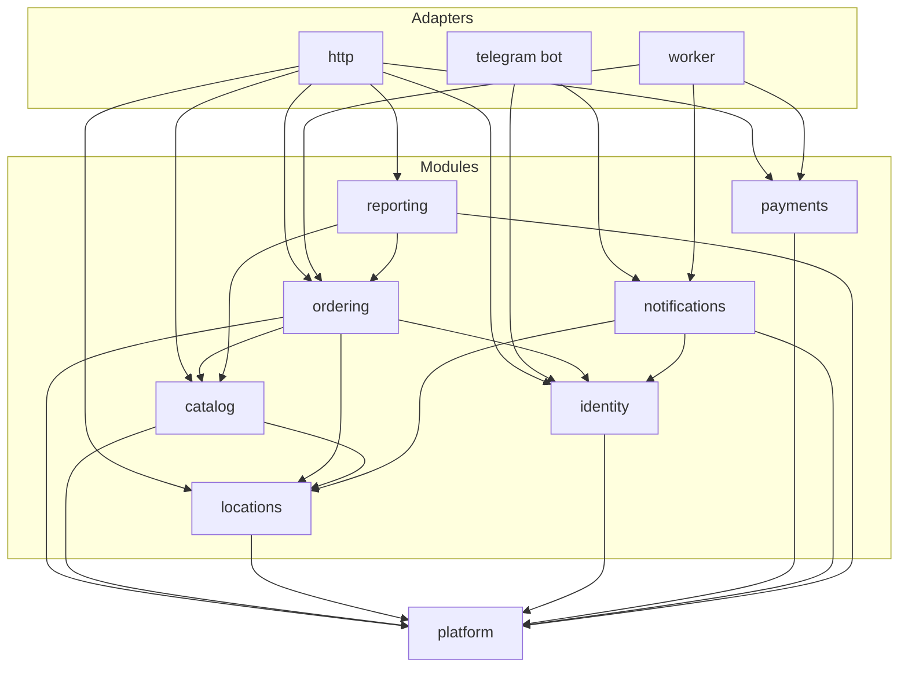
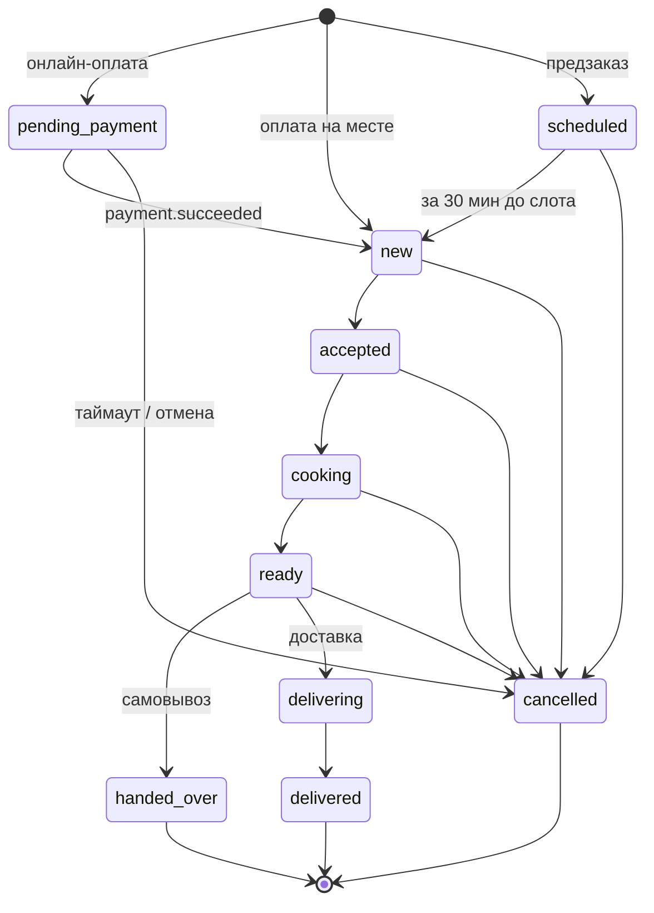
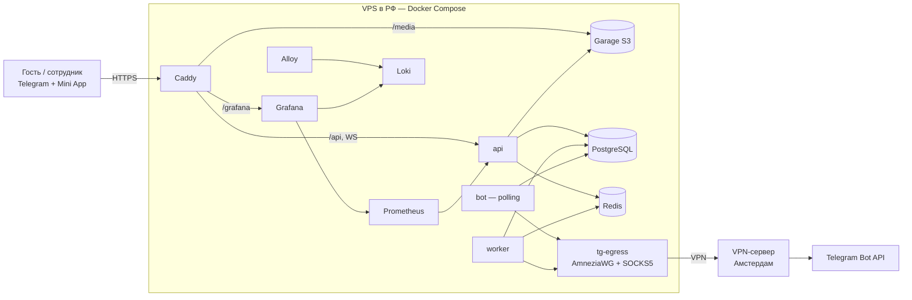
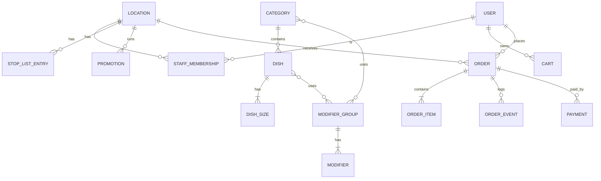

# Architecture Spine — Fenix

## Design Paradigm

**Модульный монолит.** Один бэкенд-процесс (плюс бот и воркер из того же кода), разделённый на предметные модули с собственными данными. Внешний мир — HTTP API, бот, воркер — это **адаптеры**, которые вызывают публичный API модулей.

| Слой | Где живёт | Что содержит |
| --- | --- | --- |
| Модули | `backend/src/fenix/modules/<module>/` | модели, сервисы, события, публичный API модуля |
| Адаптеры | `backend/src/fenix/http/`, `backend/src/fenix/telegram/`, `backend/src/fenix/worker.py` | роуты FastAPI, хендлеры бота, задачи воркера |
| Платформа | `backend/src/fenix/platform/` | БД, конфиг, логи, outbox, realtime, S3, auth мессенджера |
| Mini App | `webapp/src/` (`platform/`, `api/`, `guest/`, `staff/`) | один SPA для гостя и персонала |

Модули: `identity`, `locations`, `catalog`, `ordering`, `payments`, `notifications`, `reporting`.

## Invariants & Rules



### AD-1 — Модульный монолит, зависимости только сверху вниз [ADOPTED]

- **Binds:** all
- **Prevents:** логику заказов, акций и стоп-листа, размазанную по роутерам; циклические импорты между модулями.
- **Rule:** зависимости — только по стрелкам диаграммы выше. Модуль импортирует у другого только `fenix.modules.<m>.api` (публичные функции и DTO), никогда — его модели, сервисы или таблицы. Адаптеры не содержат бизнес-логики. `platform` не импортирует модули.

### AD-2 — Каждой таблицей владеет ровно один модуль [ADOPTED]

- **Binds:** all
- **Prevents:** два модуля, пишущие одну сущность; JOIN через границы модулей.
- **Rule:** владение: `identity` — пользователи, сотрудники, приглашения, согласия; `locations` — точки, часы работы, настройки, информация о кафе, служебный чат; `catalog` — категории, блюда, размеры, модификаторы, стоп-лист, акции, фото; `ordering` — корзины, заказы, позиции, журнал заказа, номера заказов; `payments` — платежи; `notifications` — outbox и попытки доставки; `reporting` — только чтение через API `ordering`/`catalog` или собственные витрины. Внешние ключи между модулями допустимы, запись — только владельцем.

### AD-3 — Жизненным циклом заказа владеет только `ordering` [ADOPTED]

- **Binds:** FR-12–FR-16, FR-20–FR-23, FR-25
- **Prevents:** изменение статуса воркером, платёжным колбэком или роутом в обход правил; двойное «Принять».
- **Rule:** статус заказа меняется только функцией перехода `ordering.api.transition(order_id, action, actor, expected_version)` по явной таблице допустимых переходов. Оптимистическая блокировка по `version`: при несовпадении — ошибка `order_conflict`, побеждает первое действие. Каждый переход пишет запись в журнал заказа и доменное событие (AD-4) в той же транзакции. Номер заказа выдаётся атомарно в транзакции создания: счётчик на точку и бизнес-день с блокировкой строки.



### AD-4 — Побочные эффекты только через transactional outbox [ADOPTED]

- **Binds:** FR-16, FR-24, NFR-2, NFR-3
- **Prevents:** потерянные уведомления при недоступности Telegram; отправку сообщения по откатившейся транзакции.
- **Rule:** модуль, меняющий состояние, записывает событие (`<module>.<entity>.<past_tense>`, например `ordering.order.accepted`) в таблицу outbox в той же транзакции. Воркер вычитывает outbox и вызывает подписчиков (`notifications`, `ordering` для `payments.payment.succeeded`) с повторами и экспоненциальной задержкой; обработчики идемпотентны по `event_id`. Payload события содержит всё, что нужно подписчикам (снимок данных заказа); подписчики не обращаются к модулю-источнику за данными. Прямые вызовы Bot API из модулей и роутов запрещены.

### AD-5 — Реальное время — WebSocket от нашего API [ADOPTED]

- **Binds:** FR-16, FR-20, NFR-4
- **Prevents:** зависимость доски заказов от Telegram; опросы с задержкой.
- **Rule:** API держит WebSocket-каналы `staff:<location_id>` и `order:<order_id>`; события из outbox-обработчика публикуются в Redis pub/sub и раздаются всем процессам API. Сообщение WS — только сигнал «что изменилось» (id, статус, version); клиент перечитывает состояние через REST. Аутентификация WS — тем же `initData`.

### AD-6 — Цену считает только сервер, одной функцией [ADOPTED]

- **Binds:** FR-4–FR-8, FR-11–FR-13, FR-23, FR-32
- **Prevents:** расхождение цены в Mini App, корзине и заказе; двойное применение скидок.
- **Rule:** вся цена вычисляется `catalog.api.price(...)` (размер + модификаторы + автоматическая акция); доставка и скидка с проверкой добавляются `ordering` из настроек `locations` и подтверждения сотрудника. К позиции применяется не больше одной акции — с наибольшей скидкой; акция «с проверкой» конкурирует с автоматическими на тех же правах. Корзина хранит только выбор (размер, модификаторы, количество), цена вычисляется при каждом чтении. Mini App не вычисляет цену. Позиция заказа хранит снимок: названия, размер, модификаторы, цены, применённую акцию. Деньги — целые копейки (`int`).

### AD-7 — Идентичность и доступ [ADOPTED]

- **Binds:** FR-9, FR-10, FR-19, FR-34, FR-35, NFR-5
- **Prevents:** склейку пользователей разных мессенджеров; проверку прав на клиенте.
- **Rule:** пользователь = уникальная пара `(platform, external_id)`, `platform ∈ {telegram, max}`. Каждый HTTP/WS-запрос Mini App несёт `Authorization: tma <initData>`; сервер проверяет подпись (HMAC от токена бота), срок `auth_date` ≤ 24 ч и получает пользователя. Сотрудник = активное членство пользователя в точке; все роуты персонала проверяют его на сервере. Ролей внутри персонала нет.

### AD-8 — Мессенджер — только адаптер [ADOPTED]

- **Binds:** FR-1, FR-16, FR-24, NFR-3; MAX после v1
- **Prevents:** Telegram-специфику в модулях; второй потребитель обновлений.
- **Rule:** модули не импортируют aiogram и SDK мессенджеров. Отправка — через интерфейс `notifications` → `MessengerGateway` с реализацией на платформу. Обновления Telegram получает только сервис `bot` (long polling); webhook не используется. Все запросы к Bot API идут через `TELEGRAM_PROXY_URL` (сервис `tg-egress`). В Mini App SDK мессенджера используется только в `webapp/src/platform/`.

### AD-9 — Оплата за интерфейсом провайдера [ADOPTED]

- **Binds:** FR-13–FR-15
- **Prevents:** привязку к конкретному эквайрингу; двойное зачисление.
- **Rule:** `payments` владеет сущностью платежа и статусом оплаты; провайдер — интерфейс (`MockProvider` до v1). Создание платежа и обработка уведомления провайдера идемпотентны по ключу (`order_id` + попытка). Успех публикуется событием `payments.payment.succeeded`; `ordering` переводит заказ (AD-3), а повторное событие для заказа, уже вышедшего из `pending_payment`, считает выполненным. Статус оплаты заказа — проекция платежа, `ordering` его не пишет.

### AD-10 — Всё, что относится к точке, имеет `location_id` [ADOPTED]

- **Binds:** NFR-8, FR-20, FR-28, FR-30, FR-31
- **Prevents:** миграцию данных при появлении второй точки.
- **Rule:** заказы, корзины, стоп-лист, часы, настройки, служебный чат, членство сотрудника, номера заказов и каналы WS содержат `location_id`. Меню (категории/блюда) — общее для сети; доступность и цены по точке — через стоп-лист и акции с `location_id`.

### AD-11 — Время [ADOPTED]

- **Binds:** FR-8, FR-20, FR-30, FR-36
- **Prevents:** сдвиг слотов, отчётов и номеров заказов на 3 часа.
- **Rule:** в БД — `timestamptz` в UTC. Бизнес-время (часы работы, слоты, «сегодня», ежедневный сброс номера заказа, границы периодов отчётов) считается в часовом поясе точки (`Europe/Moscow` по умолчанию, поле точки).

### AD-12 — Фото через наш API, хранилище закрыто [ADOPTED]

- **Binds:** FR-27, NFR-1
- **Prevents:** публичный доступ к S3; неуменьшенные фото у гостей.
- **Rule:** загрузка — `POST` в API; сервер уменьшает изображение (≤1280 px, ~300 КБ, WebP/JPEG) и сохраняет в Garage через S3 API. Ключ объекта неизменяем (новое фото — новый ключ). Гостям отдаёт Caddy по `/media/*` с долгим кешем. Наружу Garage не публикуется.

### AD-13 — Фоновая работа — только воркер taskiq [ADOPTED]

- **Binds:** FR-13 (автоотмена), FR-20 (предзаказы), AD-4
- **Prevents:** таймеры в процессе API, теряющиеся при рестарте.
- **Rule:** отложенные и периодические действия (доставка outbox, автоотмена неоплаченных, перевод предзаказов в `new`, повтор уведомлений) выполняет воркер. Отложенные действия хранятся в БД (срок в записи), а не только в очереди: воркер периодически подбирает просроченные. Изменение заказа воркером — только через AD-3.

## Consistency Conventions

| Concern | Convention |
| --- | --- |
| Окружения | локально — `infra/compose.dev.yaml`; один стенд на VPS = продакшен, деплой из `release` |
| Наблюдаемость | метрики `/metrics` (Prometheus), логи в Loki; алерты Grafana на недоступность api, bot, tg-egress и рост ошибок 5xx |
| Контракт API | REST JSON под `/api/v1` (служебные `/api/health` и `/metrics` — вне версии); схема OpenAPI из FastAPI; TS-клиент Mini App генерируется из неё в CI, ручных типов API нет |
| Ошибки | `{"error": {"code": "snake_case", "message": "...", "details": {}}}`; HTTP-коды по смыслу; `order_conflict` → 409 |
| Идентификаторы | UUIDv7 для сущностей; номер заказа для людей — отдельное поле (`#047`) |
| Имена | таблицы — `<module>_<entity>` во мн. ч. (`ordering_orders`); события — `<module>.<entity>.<past_tense>`; роуты персонала — `/api/v1/staff/...` |
| Деньги | целые копейки `int`, валюта RUB неявно |
| Время | ISO 8601 с зоной в API; UTC в БД (AD-11) |
| Миграции | Alembic, одна цепочка; модуль меняет только свои таблицы |
| Транзакции | одна транзакция на команду; событие outbox — в той же транзакции |
| Логи | structlog JSON; поля `request_id`, `location_id`, `order_id`, `user_id`; без ПДн (телефоны, адреса) в логах |
| Конфиг и секреты | переменные окружения через `fenix.config.Settings`; секреты только в `.env` сервера и GitHub Secrets |
| Тесты | pytest; бизнес-логика модулей — без HTTP; таблица переходов заказа покрыта полностью |
| Mini App | SDK мессенджера только в `src/platform/`; запросы только через сгенерированный клиент; цены не вычисляются на клиенте |

## Stack

| Name | Version |
| --- | --- |
| Python | 3.14 |
| FastAPI | 0.143.2 |
| aiogram | 3.31.0 |
| SQLAlchemy | 2.1.4 |
| Alembic | 1.20.0 |
| asyncpg | 0.32.0 |
| Pydantic | 2.13.5 |
| taskiq / taskiq-redis | 0.13.0 / 1.2.4 |
| redis-py | 8.1.0 |
| PostgreSQL | 17 |
| Redis | 8 |
| Garage | v2.4.1 |
| React | 19.3.1 |
| TypeScript | 6.0.3 |
| Vite | 8.3.4 |
| @telegram-apps/sdk | 3.11.8 |
| Caddy | 2.10 |
| Prometheus / Loki / Alloy / Grafana | 3.5.0 / 3.5.0 / 1.10.0 / 12.1.1 |

## Structural Seed





```text
backend/src/fenix/
  modules/
    identity/  locations/  catalog/  ordering/  payments/  notifications/  reporting/
      api.py        # public functions + DTOs (the only import surface)
      models.py     # tables owned by the module
      service.py    # business logic
      events.py     # event names and payload schemas
  http/          # FastAPI routers (guest, staff), WS endpoints
  telegram/      # bot service, MessengerGateway for Telegram
  platform/      # db, config, logging, outbox, realtime, s3, messenger auth
  worker.py
  # stage 0 files fenix/api/, db.py, config.py, logging.py move to http/ and platform/ in stage 1
webapp/src/
  platform/      # messenger SDK wrapper (Telegram now, MAX later)
  api/           # generated client
  guest/  staff/ # screens; staff is lazy-loaded
```

## Capability → Architecture Map

| Capability / Area | Lives in | Governed by |
| --- | --- | --- |
| Вход, информация о кафе (FR-1, FR-2, FR-33) | telegram, locations | AD-8, AD-10 |
| Меню, карточка, стоп-лист, фото (FR-3, FR-4, FR-26–FR-29) | catalog | AD-2, AD-6, AD-12 |
| Акции (FR-5, FR-11, FR-23, FR-32) | catalog (акции), ordering (подтверждение) | AD-6, AD-3 |
| Корзина и оформление (FR-6–FR-10, FR-12) | ordering, identity | AD-3, AD-6, AD-7, AD-11 |
| Оплата (FR-13–FR-15) | payments | AD-9, AD-4 |
| Статусы и уведомления (FR-16, FR-24) | ordering, notifications | AD-3, AD-4, AD-5, AD-8 |
| Кабинет гостя (FR-17, FR-18) | ordering | AD-6 |
| Доска и работа с заказами (FR-19–FR-22, FR-25) | ordering, http/staff | AD-3, AD-5, AD-7 |
| Настройки точки (FR-30, FR-31) | locations | AD-10, AD-11 |
| Персонал (FR-34, FR-35) | identity | AD-7 |
| Отчёты (FR-36) | reporting | AD-2, AD-11 |
| NFR-2, NFR-3 надёжность и независимость от мессенджера | notifications, worker | AD-4, AD-8, AD-13 |

## Deferred

- **MAX-адаптер** — после v1; точки расширения уже заданы AD-7 и AD-8.
- **Реальный эквайринг и фискализация (54-ФЗ)** — после v1; встраивается реализацией провайдера (AD-9).
- **Интеграция с кассой** — после v1; источник истины по меню остаётся в `catalog`, пока не решено иначе.
- **Бэкапы и восстановление** — до запуска v1 решение не принято; пересмотреть на этапе 5.
- **UI-кит, визуальный стиль, состояние фронтенда** — в UX-документе (`bmad-ux`), не влияет на границы модулей.
- **Версионирование схем событий** — пока события внутренние и потребители в том же коде; понадобится при выносе модуля.
- **Кеширование меню (Redis/HTTP)** — при необходимости по NFR-1 после замеров на этапе 5.
- **Отдельный хостинг Mini App вне мессенджера** — после v1.
- **Отдельный staging-стенд** — пока один стенд; понадобится, когда появятся реальные гости до v1.
