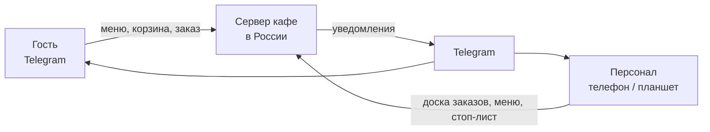
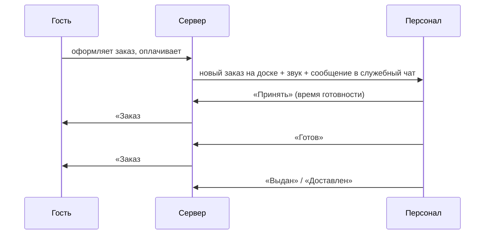

# Как устроена система «Феникс бистро»

Описание для владельца кафе и коммерческого предложения. Технические детали — в [ARCHITECTURE-SPINE.md](ARCHITECTURE-SPINE.md).

## Коротко

Гость заказывает через Telegram: бот открывает приложение с меню прямо внутри мессенджера. Персонал принимает и ведёт заказы в том же приложении — на телефоне или на планшете у кассы. Всё работает на одном сервере в России, где хранятся данные гостей.

## Из чего состоит

| Часть | Что делает |
| --- | --- |
| **Бот в Telegram** | Встречает гостя, открывает приложение, присылает уведомления о заказе. |
| **Приложение (Mini App)** | Меню, корзина, оформление и статус заказа для гостя; доска заказов, стоп-лист, меню, акции, настройки и отчёты для персонала. Одно приложение — раздел персонала видят только сотрудники. |
| **Сервер** | Хранит меню, заказы и данные гостей; считает цены и скидки; следит за статусами заказов. |
| **Хранилище фото** | Фото блюд, которые сотрудники загружают с телефона. |
| **Мониторинг** | Графики и журналы работы системы; оповещение, если что-то сломалось. |

## Как проходит заказ

## На чём держится надёжность

- **Заказ не теряется.** Сначала заказ сохраняется на сервере, и только потом отправляются уведомления. Если Telegram на минуту недоступен, сообщения дойдут, как только связь вернётся, а заказ сразу виден персоналу на доске.
- **Цену считает только сервер.** Гость, корзина и чек всегда видят одну и ту же сумму; изменение цены в меню не меняет уже оформленные заказы.
- **Два сотрудника не «примут» один заказ дважды.** Система засчитывает первое действие и предупреждает второго.
- **Номера заказов не повторяются** и каждый день начинаются заново.

## Данные и закон

- Данные гостей (имя, телефон, адрес доставки) хранятся только на сервере в России — это требование закона о персональных данных.
- Перед первым заказом гость принимает политику конфиденциальности; согласие сохраняется.
- Из-за ограничений связи с Telegram в России сообщения бота идут через отдельный защищённый канал. Данные гостей при этом остаются на российском сервере; в Telegram уходят только тексты уведомлений.

## Что можно добавить потом без переделки

- **Мессенджер MAX** — приложение и сервер уже разделены так, что второй мессенджер подключается отдельным модулем.
- **Онлайн-оплата картой** с чеками — сейчас оплата тестовая; реальный эквайринг подключается на готовое место.
- **Вторая точка** — все заказы, стоп-листы и настройки уже привязаны к точке.
- **Программа лояльности, промокоды, интеграция с кассой.**

## Этапы

| Этап | Что появится |
| --- | --- |
| 0 ✅ | Сервер, бот, приложение-заготовка, мониторинг, автоматическая выкладка обновлений |
| 1 | Меню с размерами и добавками, стоп-лист, фото, информация о кафе, доступ персонала |
| 2 | Заказ на самовывоз, оплата, доска заказов со звуком, уведомления |
| 3 | История заказов и повтор заказа |
| 4 | Доставка по ЖК, предзаказ ко времени, акции |
| 5 | Отчёты, проверка под нагрузкой, запуск для гостей |
